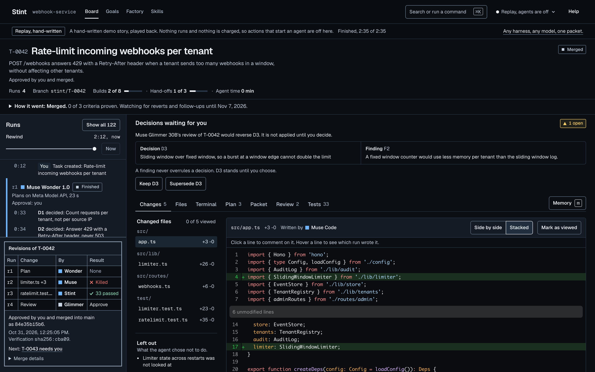

<p align="center">
  <picture>
    <source media="(prefers-color-scheme: dark)" srcset="assets/logo-dark.png">
    
  </picture>
</p>

<h3 align="center">The task outlives the agent.</h3>

Coding agents are good at a task until the session ends: the context fills up, the process dies, a rate limit hits, or you want a different agent for the next step. Stint makes the task, not the chat, the unit of work. The task is a folder in your repository that any agent can pick up. Every run gets its own git worktree, the daemon runs the tests itself, and when a run ends, however it ends, Stint writes a packet of a few hundred tokens that the next agent continues from. A local model reviews, and only you merge. It runs on Meta's Muse models by default, on your own machine.

<p align="center"></p>

## Three proofs

| Claim | What happens | Evidence |
|---|---|---|
| A killed agent's work survives | Muse Code builds T-0042 on Muse Spark 1.3 and is killed mid-run. The daemon builds the packet from the log and the diff alone, and names the step that was in flight as unknown. The Stint agent, also on Muse Spark 1.3, continues from the packet. | Live, 26 October: the continued run finished, and the daemon's own `bun run test` passed 29 of 29 for $0.10 (120,218 input tokens, 76,093 of them cached). The recorded replay's packet is 412 tokens. Test: `packages/daemon/test/continue.live.test.ts`; its replay twin runs in CI. |
| Review costs nothing and needs no network | Muse Glimmer 30B reviews on the laptop through Ollama. A finding that would reverse a recorded decision is not applied. It waits in a queue until a person keeps or supersedes the decision. | `review.recorded { offline: true }` at $0.00. Test: `packages/daemon/test/review.contradiction.test.ts` |
| It learns | When the same finding shows up on two tasks, the learn step proposes a skill with that evidence. Nothing is written until a person approves it, and the next task runs with it. | T-0040 and T-0042 share the hard-coded limit finding. That raised `limiter-config-via-env`, and T-0043 applied it and got no review finding on that point. Test: `packages/daemon/test/learn.test.ts` |

The replay's story (T-0040, T-0042 and T-0043, with its 412-token packet) is hand-written and says so on screen; the measured numbers come from live runs on Meta's models. [`docs/proofs.md`](docs/proofs.md) holds the records: what is real and what is replayed, the live packet, the benchmark (packets 7 times smaller than transcripts, 9 of 10 continued runs green against 3 of 5), where each Meta model works, and what was built during the hackathon.

## Quick start

<!-- needs: network (the clone downloads the repository and bootstrap runs bun install) -->
```bash
git clone https://github.com/QuintinBotes/stint && cd stint
bash scripts/bootstrap.sh
```

Bootstrap checks Bun and git, installs the dependencies, unpacks the demo repository, and replays the recorded story through the real daemon. It needs no keys. When Ollama is installed and Muse Glimmer 30B is not, it also starts that 19 GB download in the background. On CI, from a clean clone, these steps take about 10 seconds once the clone is done. It opens the UI in your browser and prints the address. Timing (`/`) shows every task by stage; open T-0042 for its runs, the kill, the hand-off, the offline review and the merge. The strip under the top bar says it is a replay. Press Ctrl-C to stop it.

## Install

| What | Version | Needed for |
|---|---|---|
| [Bun](https://bun.sh) | 1.3.14 or later | everything |
| git | 2.40 or later | everything |
| [Ollama](https://ollama.com) with `muse-glimmer:30b-mlx` | 0.32.8 or later | the offline review (optional) |
| [Muse Code](https://dev.meta.ai) | 1.4 or later, logged in | building with Muse Code (optional) |
| `META_API_KEY` | | hosted planning and the Stint agent (optional for the replay) |

Put the `stint` command on your PATH, then check it:

```bash
bash scripts/install-cli.sh
stint --help
```

`stint doctor` checks everything else in the repository you run it in, one line per check with the command that fixes it. [`docs/setup.md`](docs/setup.md) is the full guide.

## Use it on your repository

1. **Init.** In your repository, with a clean working tree:

```bash
cd /path/to/your/repo
stint init
git add .gitignore AGENTS.md .stint/config.json && git commit -m "Add Stint"
```

```text
Wrote .stint/config.json, .gitignore, AGENTS.md
For Muse Code's hooks, install and approve the Stint plugin once:
  muse plugins install /path/to/stint/packages/adapters/muse-code/plugin --scope user
  muse plugins approve stint
```

2. **Keys.** Save them once, for every repository; the value is never echoed or logged:

<!-- needs: META_API_KEY -->
```bash
stint keys set META_API_KEY
```

For the offline review, pull Glimmer once ([setup](docs/setup.md#the-offline-review)).

3. **Start Stint.** Leave it running and open a second terminal in the same folder:

```bash
stint up
```

```text
Stint is running at http://127.0.0.1:52391
```

4. **New task.** Say what done looks like:

```bash
stint new "Add a health endpoint" --accept "GET /health answers 200 with the version"
```

```text
T-0001
```

5. **Run it.** Autopilot plans, builds, verifies and reviews, then stops at your approval:

```bash
stint run T-0001 --wait
```

```text
T-0001 is on autopilot. It stops at your approval.
T-0001: Waiting for your approval.
```

6. **The gate.** Open the address `stint up` printed, then T-0001: it waits with the diff, the daemon's verification and the review. The packet the next agent would read is in the terminal too:

```bash
stint packet T-0001
```

7. **Approve.** A real merge, with `Stint-Task` trailers that say which runs and packet it came from:

```bash
stint approve T-0001
```

```text
Merged T-0001 into main as 3f2a9c1.
```

## Everyday commands

| Command | What it does |
|---|---|
| `stint up` | Start the daemon and the UI for this repository |
| `stint doctor` | Check the machine and repository, with a fix for each problem |
| `stint new "<title>" --accept "<criteria>"` | Create a task |
| `stint run <task> --wait` | Plan, build, verify and review, stopping at your approval |
| `stint hand <task> <agent>` | Hand the task to another agent from its packet |
| `stint packet <task>` | Show the packet the next agent reads |
| `stint approve <task>` | Merge the verified change |
| `stint reject <task> --reason "<why>"` | Send it back with the reason as the next run's ask |
| `stint costs --by host` | Spend by task, run, day or host |
| `stint keys list` | Where each key comes from, never its value |
| `stint demo` | Replay the recorded story; `--live` runs it with your keys |
| `stint mcp` | Serve Stint's tools to any MCP client |

## Agents and models

Muse Code and the Stint agent build on Muse Spark 1.3, Muse Wonder plans, and Muse Glimmer 30B reviews offline. Other agents ship turned off. To turn one on, edit its entry under `agents` in `.stint/config.json` and restart `stint up`. Setting these three fields in the `claude-code` entry runs Claude Code on Muse Glimmer 30B through Ollama:

```json
"claude-code": { "enabled": true, "host": "ollama", "model": "muse-glimmer:30b-mlx" }
```

[`docs/agents.md`](docs/agents.md) covers Claude Code, Codex, goose, opencode, Gemini CLI, aider and any Agent Client Protocol agent, local models through Ollama, LM Studio or llama.cpp, and hosted Muse Spark Open.

## Troubleshooting

| Symptom | Cause | Fix |
|---|---|---|
| `dirty_tree` when a run starts | uncommitted changes to tracked files | `git stash` |
| `adapter_unavailable` for an agent | its command is not on PATH, or no host in the Stint agent's chain has a key or is running | `stint doctor` |
| The review says Glimmer is not pulled | the offline reviewer model is missing | `ollama pull muse-glimmer:30b-mlx` |
| `stint up --port 4319` says the port is in use | another program has it | `stint up --port 0` picks a free one |
| A key works in one folder and not another | it is in one repository's `.env`, which only that repository reads | `stint keys set META_API_KEY` |
| Bootstrap or doctor says Bun is too old | Bun before 1.3.14 | `bun upgrade` |
| A Muse Code run fails with Muse's own sign-in message | `muse` is not logged in | `muse login` |
| A partner host answers 403 | the key is wrong or has text after it | `stint keys set BASETEN_API_KEY` |

## How it works

- A daemon (Bun and Hono) on 127.0.0.1 is the only writer of `.stint/`; the CLI and the UI ask it.
- Every view is projected from each task's hash-chained `events.jsonl`, so the folder is readable without Stint.
- Each run gets its own worktree; the daemon runs the tests and locks the test files the plan and the task name ([`docs/verify.md`](docs/verify.md)).
- Every ending writes a packet (`stint.handoff/1`), never a transcript ([`docs/packet.md`](docs/packet.md)).
- Adapters drive the agents and never touch the store ([`docs/adapters.md`](docs/adapters.md)).
- The factory around the hand-off: escalation, best of n, memory, skills and evals, outcomes after merge ([`docs/factory.md`](docs/factory.md)).

## More

[`docs/`](docs/README.md) lists every guide. To contribute, see [`CONTRIBUTING.md`](CONTRIBUTING.md); to report a security problem, see [`SECURITY.md`](SECURITY.md). Licensed under [MIT](LICENSE).

Built with Muse Spark Open.
