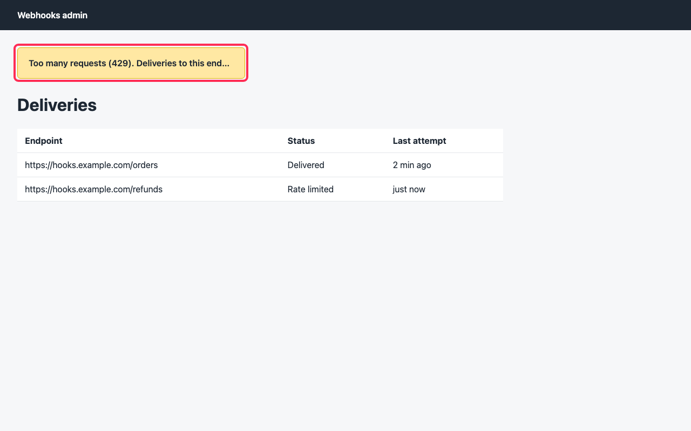

# Visual set

This folder asks how often Stint's visual check is right, on ten pages: five with one seeded defect each and five clean. It is for anyone checking the visual claim in `docs/proofs.md`, which until now rested on one seeded page (`bench/visual/`).

## What was run

On 2 November 2026, `scripts/visual-set.ts` put each page in `pages/` through the daemon's own verifier, the way `bench/visual/run.ts` does: a fresh repository that serves the page as `/admin` with `bench/visual/fixture/serve.ts`, a task with one criterion and one visual proof, a worktree, and `DaemonVerifier.verify`. That runs `packages/daemon/src/visual.ts` unchanged. Headless Chromium takes a 1280 by 800 screenshot, Muse Spark 1.3 on the Meta Model API (`meta-api/muse-spark-1.3`) judges it against the criterion, and when the criterion does not hold, SAM 3.1 (`meta-api/sam-3.1`) looks for the element Muse Spark named and Stint draws its box on a copy.

All ten pages use the criterion and proof of `bench/visual/`, word for word:

- criterion: "The admin page tells an over-limit tenant when to try again"
- proof: `/admin :: a 429 banner saying try again in 60 s`

Every page is served at the same path from its own repository, so the prompt is the same for all ten and no file name reaches the model. The task's test command is the stand-in `bench/visual/` uses, which prints one pass, so only the visual check could turn a page red. Each page ran once, in the order of `pages.json`, and the script skips any page already in `results.json`, so no result was run again.

## The pages

Each page is the fixture's admin page (`bench/visual/fixture/site/admin.html`) with one change.

| Page | Kind | What changed |
|---|---|---|
| `defect-overflow` | defect | The banner is capped at 380 px on one line and cut with an ellipsis: "Too many requests (429). Deliveries to this end...", so the retry time never shows |
| `defect-contrast` | defect | The banner's text is #f7dc90 on #ffe8a3, a contrast of 1.11 to 1 where WCAG AA asks for 4.5 to 1 |
| `defect-template` | defect | An unfilled template: "Try again in {{retryAfter}} s." |
| `defect-overlap` | defect | A "New: delivery logs now keep 30 days" popover covers the left half of the banner and all of its text |
| `defect-label` | defect | "Please try again later.", with no time |
| `clean-baseline` | clean | The `bench/visual/` page with the value fixed: "Try again in 60 s." |
| `clean-seconds` | clean | The unit spelled out, "Try again in 60 seconds.", and a third delivery row |
| `clean-error-style` | clean | A red error banner with a 429 badge |
| `clean-busy` | clean | A tab bar, a summary line and five deliveries around the same banner |
| `clean-dark` | clean | A dark theme, #ffe8a3 text on a #3d3210 banner (10.42 to 1) |

## Results

| Measure | Result |
|---|---|
| Defects caught (judged not to hold) | 4 of 5 |
| Clean pages wrongly failed | 0 of 5 |
| Caught defects SAM 3.1 boxed | 2 of 4 |
| Boxes on the seeded element | 2 of 2 |
| Pages not checked | 0 of 10 |
| Cost | $0.0489: $0.0389 for Muse Spark, $0.0100 for SAM's four images |

A box is on target when at least half of it lies on an element the page seeded (`targets` in `pages.json`). The elements' boxes were measured in the same Chromium at 1280 by 800, and SAM's box is scaled from its own frame as the verifier scales it to draw it. The `visual.checked` event does not carry SAM's box, so the script reads it from SAM's answer as the verifier receives it.

| Page | Verification | Muse Spark 1.3 said | Element it named | SAM 3.1's box | Output tokens | Cost |
|---|---|---|---|---|---|---|
| `defect-overflow` | red | "The banner fails to tell the user to try again in 60 s." | yellow banner | the clipped banner, all of the box on it | 545 | $0.0070 |
| `defect-contrast` | green, a miss | holds: "The page shows a yellow banner stating Too many requests (429) with retry in 60 s" | none | not asked | 804 | $0.0058 |
| `defect-template` | red | "The banner shows the unrendered placeholder {{retryAfter}} instead of 60 s." | 429 banner | no match | 416 | $0.0064 |
| `defect-overlap` | red | "There is no visible 429 message telling the user to try again in 60 s." | yellow banner | no match | 647 | $0.0074 |
| `defect-label` | red | "The banner says to try again later instead of specifying try again in 60 s." | yellow banner | the banner, all of the box on it | 390 | $0.0062 |
| `clean-baseline` | green | holds | none | not asked | 359 | $0.0034 |
| `clean-seconds` | green | holds | none | not asked | 365 | $0.0036 |
| `clean-error-style` | green | holds | none | not asked | 242 | $0.0028 |
| `clean-busy` | green | holds | none | not asked | 322 | $0.0032 |
| `clean-dark` | green | holds | none | not asked | 264 | $0.0031 |

Muse Spark read 1,439 input tokens on every page, 158 of them cached on four pages. SAM 3.1 is billed per image, $0.0025, whether or not it finds a match.

## What it shows

On this page and this criterion, Muse Spark 1.3 failed 4 of the 5 seeded defects, and each sentence names the fault: a cut-off banner, an unfilled placeholder, a popover over the text, a "later" with no time. It passed all 5 clean pages, including a reworded unit, a red style, a busier page and a dark theme. Both boxes SAM 3.1 drew lie on the seeded banner.

## What it does not show

- That the check catches what a person cannot read. Text at 1.11 to 1 is unreadable to a person, but Muse Spark read "60 s" off the screenshot and passed the page. The check asks whether the words are on screen, not whether a person can read them.
- That a red check always comes with a box. SAM 3.1 found no match for 2 of the 4 caught defects ("429 banner" on the template page, "yellow banner" on the page where the popover covers it). Those verifications are red with Muse Spark's sentence and the plain screenshot, and each SAM call was still billed.
- A rate. n = 10 is one page, one criterion and one run per page. The exact 95% intervals are wide: 4 of 5 caught fits a true catch rate from 28% to 99%, 0 of 5 wrongly failed fits a false-alarm rate up to 52%, and 2 of 2 boxes on target fits a rate as low as 16%.
- Defects anywhere else. Every defect is on the banner the criterion names, on pages written for this set. A defect elsewhere on a page, a flow across pages, or a real app's own rendering is not measured.
- Repeatability. Each page ran once; how often Muse Spark gives a different verdict on the same screenshot is not measured.

## Files

- `pages.json`: the criterion, the proof, and each page with what changed and the selectors of the elements it seeded.
- `pages/<page>.html`: the ten pages.
- `results.json`: every page's verification, Muse Spark's verdict in full, SAM's box in screenshot pixels with its confidence, the seeded elements' boxes, the share of the box on them, tokens and cost, and the tables above. The clip of each page load is not kept.
- `shots/<page>.png`: the screenshot Muse Spark judged. `shots/<page>-marked.png`: the copy with SAM's box, for the two pages it boxed.

Run it again with `STINT_LIVE=1 bun --env-file=<your env file> scripts/visual-set.ts --budget-usd 0.75`. It runs only the pages not yet in `results.json`, so this run is never replaced; to run the set again, move `results.json` and `shots/` aside first.
