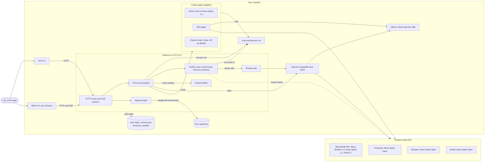
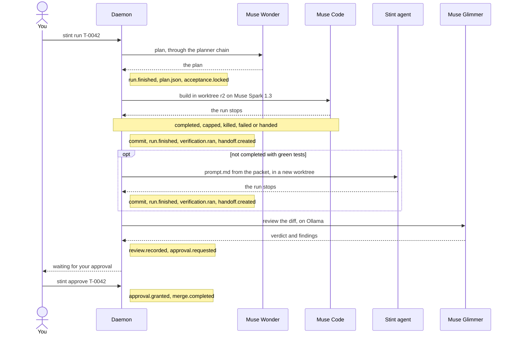

# Architecture

Stint is a local control plane for AI-built software in which the task, not the chat, is the unit of work. Each task is a folder in your repository, each run of an agent gets its own git worktree, and a daemon on your machine runs the tests itself. When a run ends, however it ends, the daemon writes a packet of a few hundred tokens from the event log and the diff, and the next agent continues from that packet, not from the transcript. A local model reviews, and by default only you merge. This page shows the parts, one task's life, and which model answers each role.

## The parts

Everything inside "Your machine" runs locally. The default review runs on Ollama first and leaves your machine only when Ollama cannot answer: the reviewer chain below then moves to a hosted model. `stint review --host ollama` keeps a review on Ollama. While it runs, the daemon is the only writer of `.stint/`: the CLI and the web UI send every change to it over HTTP with a token. That is the daemon's token, or for an agent's hooks, a token that opens only its own run's routes and stops working when the run ends. Adapters report through one contract and never touch the store, so every agent's work lands in the same hash-chained log, where each row carries the hash of the one before. The exceptions are setup: `stint init` writes the first `.stint/config.json`, `stint demo seed` writes the demo tasks, and `stint eval` records a result itself when no daemon is running.

Where this lives:

- [`packages/daemon/src/app.ts`](../packages/daemon/src/app.ts): the Hono app, the token check, the SSE streams `/api/stream` and `/api/tasks/:id/stream`, and the UI it serves.
- [`packages/daemon/src/server.ts`](../packages/daemon/src/server.ts): `startDaemon` and `defaultAdapters()`, the adapters that are on.
- [`packages/daemon/src/routes/`](../packages/daemon/src/routes/): the HTTP routes, one file per area.
- [`packages/core/src/store/workspace.ts`](../packages/core/src/store/workspace.ts) and [`packages/core/src/store/eventlog.ts`](../packages/core/src/store/eventlog.ts): the `.stint/` store and the hash-chained `events.jsonl`.
- [`packages/daemon/src/worktree.ts`](../packages/daemon/src/worktree.ts): a worktree per run on the branch `stint/<task>`.
- [`packages/daemon/src/verifier.ts`](../packages/daemon/src/verifier.ts), [`packages/daemon/src/acceptance.ts`](../packages/daemon/src/acceptance.ts), [`packages/daemon/src/scenarios.ts`](../packages/daemon/src/scenarios.ts) and [`packages/daemon/src/visual.ts`](../packages/daemon/src/visual.ts): the verify suite, the test lock, held-out scenarios and visual checks ([`verify.md`](verify.md)).
- [`packages/core/src/adapter.ts`](../packages/core/src/adapter.ts): the adapter contract; the adapters are in [`packages/adapters/`](../packages/adapters/) ([`adapters.md`](adapters.md)).
- [`packages/adapters/openai-compatible/src/host.ts`](../packages/adapters/openai-compatible/src/host.ts): one client for every OpenAI-compatible host.
- [`packages/cli/src/client.ts`](../packages/cli/src/client.ts) and [`apps/web/src/api.ts`](../apps/web/src/api.ts): how the CLI and the UI reach the daemon.

## One task's life

Autopilot decides each next step from the task's log alone, so a daemon restart resumes from the same place, and a run the restart cut off is closed as killed through the same path. Whatever way a run stops, the daemon commits what the worktree holds, records `run.finished` with the ending, runs the verify suite, and builds the packet from the log and the diff. A killed agent is not asked anything: its last tool call with no result goes into the packet as an unknown step. A run that did not end completed with green tests goes to the next agent in `autopilot.implementers`, with the packet as its prompt. Review is offered only after a green verification. A finding that would reverse a recorded decision waits for you, and approve merges only the commit the daemon verified, with `Stint-Task` trailers.

Where this lives:

- [`packages/daemon/src/autopilot.ts`](../packages/daemon/src/autopilot.ts): `nextStep`, the next step from the log, and the next implementer.
- [`packages/daemon/src/lifecycle.ts`](../packages/daemon/src/lifecycle.ts): `assign` starts a run, `closeRun` commits, records, verifies and asks for the packet, and `recoverRuns` closes runs a restart cut off.
- [`packages/daemon/src/handoff.ts`](../packages/daemon/src/handoff.ts) and [`packages/daemon/src/routes/handoff.ts`](../packages/daemon/src/routes/handoff.ts): the packet from the log and the diff, and the stop and hand routes ([`packet.md`](packet.md)).
- [`packages/daemon/src/prompt.ts`](../packages/daemon/src/prompt.ts): `prompt.md`, the rendered packet, the plan, the skills and the diff.
- [`packages/daemon/src/routes/models.ts`](../packages/daemon/src/routes/models.ts): the plan and the review, each a run on the timeline.
- [`packages/daemon/src/routes/approve.ts`](../packages/daemon/src/routes/approve.ts): the gate's checks and the merge.
- [`packages/core/src/schemas/event.ts`](../packages/core/src/schemas/event.ts): `EVENT_TYPES`, every event name.

## Which model answers each role

Each role walks its chain in order. The defaults are `routes` in `DEFAULT_CONFIG`. A task's own `routes` can replace its planner, reviewer and summary chains.

| Role | Set by | Chain, first to last |
|---|---|---|
| Planner | `routes.planner` | `meta-api/muse-wonder-1.0`, `fireworks/muse-spark-open`, `baseten/muse-spark-open`, `modal/muse-spark-open`, `ollama/muse-glimmer:30b-mlx` |
| Implementer | `adapters.muse-code` | Muse Code on `muse-spark-1.3` through its own login; no host chain. A run that does not end completed with green tests goes to the next agent in `autopilot.implementers`: `muse-code`, then `stint-agent` |
| Continuer | `routes.agent` | The Stint agent on `meta-api/muse-spark-1.3`, `fireworks/muse-spark-open`, `baseten/muse-spark-open`, `modal/muse-spark-open`, `ollama/muse-glimmer:30b-mlx` |
| Reviewer | `routes.reviewer` | `ollama/muse-glimmer:30b-mlx`, `fireworks/muse-spark-open`, `baseten/muse-spark-open`, `modal/muse-spark-open`, `meta-api/muse-spark-1.3` |
| Learn | `routes.learn` | `baseten/muse-spark-open`, `meta-api/muse-spark-1.3`, `modal/muse-spark-open`, `ollama/muse-glimmer:30b-mlx` |
| Spec drafts | `routes.draft` | `meta-api/muse-spark-1.3`, `fireworks/muse-spark-open`, `baseten/muse-spark-open`, `meta-api/muse-wonder-1.0`, `ollama/muse-glimmer:30b-mlx` |
| Summaries | `routes.summary` | `ollama/muse-glimmer:30b-mlx`, `meta-api/muse-spark-1.3`, `baseten/muse-spark-open` |
| Packet quiz | `routes.quiz` writes the facts, `routes.recall` answers them from the packet | `meta-api/muse-wonder-1.0`, `meta-api/muse-spark-1.3`, `fireworks/muse-spark-open`, `baseten/muse-spark-open`; then `ollama/muse-glimmer:30b-mlx`, `meta-api/muse-spark-1.3`, `baseten/muse-spark-open` |
| Sharpen | `routes.sharpen` | Unset by default, so the planner chain |

A host with no key set or not running, a 429, a 5xx or a timeout moves the call to the next entry and records `provider.fallback` with the reason. For the daemon's own calls, two answers that do not fit the schema the call asked for move it on too, and their cost is still counted. When every entry fails, the call fails, and the daemon's error names each host and its reason. Every run records which host answered, and the cost meter prices it by host.

Where this lives:

- [`packages/core/src/schemas/config.ts`](../packages/core/src/schemas/config.ts): `DEFAULT_CONFIG`, with the hosts, the routes and the prices.
- [`packages/daemon/src/route.ts`](../packages/daemon/src/route.ts): `walkChain`, the walk for planning, review, learn, drafts and summaries.
- [`packages/adapters/openai-compatible/src/host.ts`](../packages/adapters/openai-compatible/src/host.ts) and [`packages/adapters/openai-compatible/src/errors.ts`](../packages/adapters/openai-compatible/src/errors.ts): a missing key, a 429 and a 5xx as a `HostError`, two invalid answers as a `StructuredOutputError`.
- [`packages/adapters/stint-agent/src/index.ts`](../packages/adapters/stint-agent/src/index.ts): the Stint agent's own walk of `routes.agent`, turn by turn.
