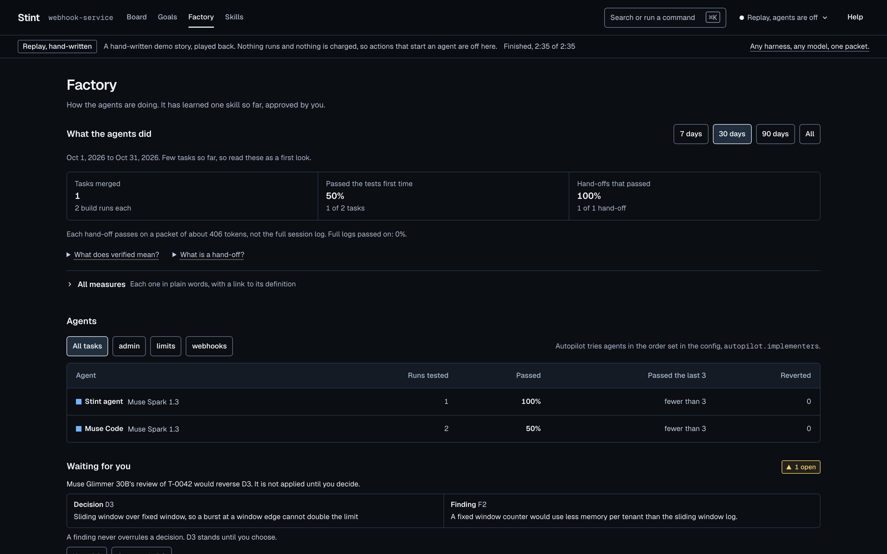

# The factory

This page is for anyone who wants the whole picture: what each screen of the web UI shows, and the loop Stint runs around every hand-off.

## What you see

- **Board** (`/`): every task by stage, each card showing the agents that worked on it and who holds it now. Issues pulled from GitHub or Linear wait in an intake panel until you accept them. Run all puts every planned task on autopilot.
- **Task view** (`/t/<task>`): the task, its acceptance criteria and its spend across the top. The runs are on the left, one agent after another with every hand-off. In the middle:
  - the diff, and the worktree's files with "Open in your editor";
  - a terminal in the worktree;
  - the plan and the packet;
  - the review, one row per lens;
  - the daemon's verification: "33 passed, tests unchanged".

  The memory panel on the right shows similar tasks, the decisions that constrain this one, and a scrubber that goes back in time. The approval gate opens only on a green verification, and shows the change's risk tier.
- **Factory** (`/factory`): who carried each task and what they handed on, which Muse model did what and what it cost. Also there:
  - a scoreboard per agent and model;
  - outcomes after merge (reverts, follow-ups, failing CI);
  - the auto-approve lane's shadow record;
  - scheduled upkeep;
  - every harness and host this workspace can use.
- **Goals** (`/goals`): outcomes bigger than one task. The list shows each goal's status, how many of its criteria are met, its tasks and its spend against its limit. A goal's page shows its outcome, each criterion with its state and the tasks covering it, Sharpen, Split into tasks, the tasks with how each went, and its spend and build meters ([`sharpen.md`](sharpen.md#goals)).
- **Skills** (`/skills`): what the agents load before a run, learned or written by hand, with evidence, an eval with and without, and a track record.

<p align="center"></p>

## The loop around the hand-off

Each part has its own page:

- **Verification an agent cannot fake.** The daemon runs the tests and the configured checks. The test files a task names are locked at plan time, so an agent that weakens them fails. Held-out scenarios run in a checkout the agent never sees ([`verify.md`](verify.md)).
- **Hand-offs that get smarter.**
  - A task escalates after repeated failures.
  - Best of n builds candidates in parallel and keeps the best green one.
  - No model reviews its own work.
  - Reviews run per lens: general, security and spec fit ([`agents.md`](agents.md)).
- **Plans that remember.** The planner reads similar tasks and the decisions on the files it will touch. It splits big tasks into subtasks that run in dependency order.
- **Learning that is measured.** A learned skill starts on probation, carries an eval with and without it, and is proposed for retirement if it hurts. Golden tasks report pass@1 and pass^3 ([`evals.md`](evals.md)).
- **After merge.** Reverts, follow-up work, failing CI and incidents are linked to the task that caused them. Approve can open a pull request and follow its checks ([`release.md`](release.md)).
- **Boundaries.**
  - Keys stay in the daemon.
  - A default-deny egress proxy and a sandbox-exec or docker sandbox per run, both off by default.
  - Risk tiers on every change.
  - An auto-approve lane that is off and must be earned on a shadow record ([`sandbox.md`](sandbox.md)).
- **Work from where teams track it.** Issues from GitHub and Linear arrive triaged. Doc gardening and drift tasks run on a schedule.
- **Any harness, any model.**
  - Muse Code and the Stint agent by default.
  - Claude Code, Codex, and any Agent Client Protocol agent (goose, opencode, Gemini CLI) as off-by-default config entries.
  - A scoreboard that can route by results, and OpenTelemetry traces for any eval tool ([`otel.md`](otel.md)).
- **Stint builds Stint.** `scripts/loop.sh --self` turns the next spec into a Stint task that stops at your approval, and `stint report` writes the build record from `.stint/`.

## Limits you set

Each task has limits on what autopilot may use before it stops and asks you:

| Limit | Default | What counts |
|---|---|---|
| Builds | 8 | Agent runs that build the change. Work taken over from a best-of-n candidate counts on the candidate. |
| Hand-offs | 3 | Times another agent starts from a run's packet, whether autopilot, an escalation or a person handed it on. |
| Review rounds | 1 | Builds started because a review asked for changes. |
| Spend | no limit | Dollars spent on the task's runs and its other model calls: the packet digest, the pick, the learn step and the quiz. |
| Agent time | no limit | Minutes from the start to the end of each run, a run still going included. |

The counts cover the task's whole life, so switching autopilot off and on does not reset them. Autopilot checks before each step. It starts no build or hand-off past the build limit, no hand-off past the hand-off limit, and no build a review asked for past the review round limit. Once the spend or agent time limit is reached, it starts nothing new. It also skips a build whose expected cost would pass the spend limit; the expected cost is the median of this task's earlier builds.

Set them in the New task dialog under Limits, with `stint new "<title>" --max-builds 4 --max-usd 3`, or as the defaults for new tasks in `.stint/config.json`:

```json
"limits": { "builds": 8, "handoffs": 3, "reviewRounds": 1, "usd": null, "minutes": null }
```

A task's own value wins over the default, and `null` means no limit. A config with no `limits` keeps `autopilot.maxHops` as the hand-off limit, so an older config means what it did.

When a limit is reached, the daemon records `limit.reached` with the limit, what was used and the cap. It then stops autopilot with "Needs you" and a plain reason, such as "Needs you: the build limit is reached (8 of 8)." The task's status stays as it was. The task view shows a meter per limit in its title block; the one reached turns amber, with two ways on:

- **Raise the limit:** type the new limit in place. Stint records `limits.changed` and puts the task back on autopilot.
- **Hand to another agent:** the hand-to control on the packet tab.

From a terminal, `stint limits <task>` prints the meters, and `stint limits <task> --max-builds 10` or `--none usd` changes them. Changing a limit this way does not restart autopilot; `stint run <task>` does.

### A goal's limits

A goal can set a spend limit and a build limit for all of its tasks together. Before a build of a task with a goal, autopilot adds up the spend and the builds of every task in the goal and stops when the goal's limit is reached, or when one more build at the task's usual cost would pass its spend limit. It records `limit.reached` with `scope: "goal"` and the goal's id, and the stop names the goal: "Needs you: the goal's $5.00 spend limit is reached ($5.10 spent across G-0001's tasks)." The task view then sends you to the goal, where "Change the goal's limits" raises them (`PATCH /api/goals/:id/limits`, recorded as `limits.changed` with the goal's id). Each task made from a goal takes its share of the goal's spend and builds as its own limits, so a task usually stops at its own limit first; the goal's limit holds when you raise a task's own. The goal's own sharpen round and split are not counted against it.

## Stint as a tool for any agent

`stint mcp` serves Stint over MCP: the task list, packets, similar tasks, the decisions that constrain a file, recording a decision, handing off, autopilot and verify. The Stint plugin registers it for Muse Code, so Muse Code can read the memory mid-session. Any other MCP client can connect too. Approving and merging stay with a person. See [`mcp.md`](mcp.md).
